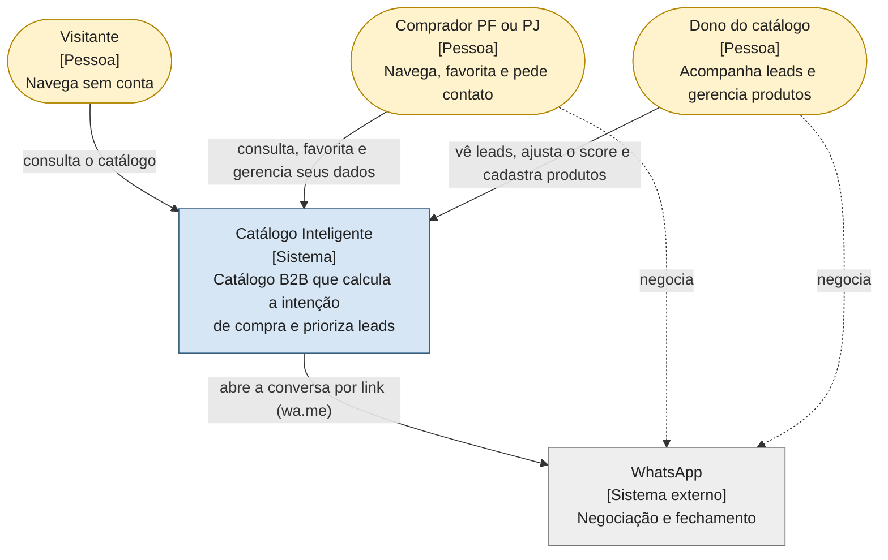
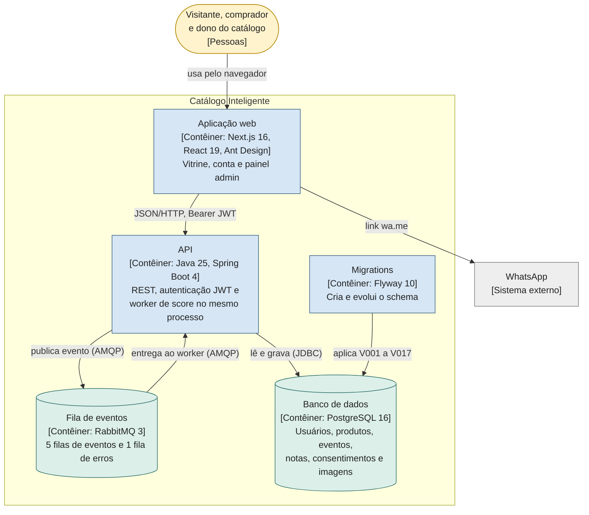
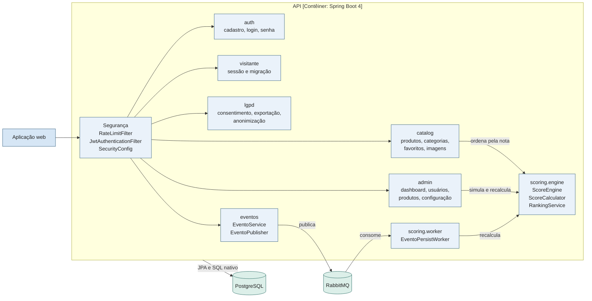
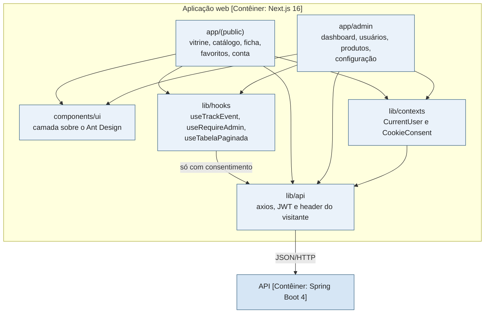
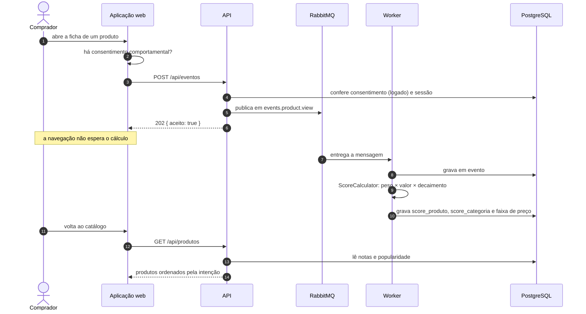

# Arquitetura

Visão arquitetural do sistema no modelo **C4** (contexto, contêineres e componentes), seguida do caminho de um evento e da mensageria. Detalhes por camada: [10 — Frontend](10-ARQUITETURA-FRONTEND.md), [12 — Backend](12-ARQUITETURA-BACKEND.md), [08 — Modelo de dados](08-MODELO-DE-DADOS.md) e [11 — API](11-API-ENDPOINTS.md).

| Nível | Pergunta que responde |
|---|---|
| [C4-1: Contexto](#1-c4-1-contexto) | Quem usa o sistema e com o que ele se conecta? |
| [C4-2: Contêineres](#2-c4-2-contêineres) | Quais aplicações e bancos formam o sistema? |
| [C4-3: Componentes do backend](#3-c4-3-componentes-do-backend) | Como a API está dividida por dentro? |
| [C4-3: Componentes do frontend](#4-c4-3-componentes-do-frontend) | Como a aplicação web está dividida por dentro? |

Legenda dos diagramas: pessoa em amarelo, parte do sistema em azul, banco e fila em verde, sistema externo em cinza.

---

## 1. C4-1: Contexto

O Catálogo Inteligente fica entre quem compra e quem vende. A negociação termina fora dele, no WhatsApp.

A integração com o WhatsApp é um link `wa.me` com a mensagem pronta. Não há uso da API do WhatsApp.

---

## 2. C4-2: Contêineres

| Contêiner | Responsabilidade | Onde |
|---|---|---|
| Aplicação web | Telas, coleta de eventos no navegador e consentimento | [`frontend/`](../frontend/) |
| API | Regras de negócio, segurança, publicação e consumo de eventos, cálculo da nota | [`backend/`](../backend/) |
| Fila de eventos | Separa a resposta da API do cálculo da nota | [`database/docker-compose.yml`](../database/docker-compose.yml) |
| Banco de dados | Persistência, com `metadados` em JSONB | [`database/`](../database/) |
| Migrations | Única fonte do schema; a API não altera tabelas | [`database/migrations/`](../database/migrations/) |

---

## 3. C4-3: Componentes do backend

Um pacote por domínio (ADR-B02). O worker roda no mesmo processo da API (ADR-B07).

O `ScoreCalculator` é uma função sem acesso a banco. Por isso, o worker e a simulação do admin usam a mesma conta.

---

## 4. C4-3: Componentes do frontend

---

## 5. Caminho de um evento até a nota

---

## 6. Mensageria assíncrona

- **Desacoplamento:** a API publica e responde; não espera o cálculo da nota ([RNF02](02-REQUISITOS.md)).
- **Absorção de picos:** a fila guarda os eventos até o worker processar.
- **Filas por natureza do evento:** permite separar consumidores no futuro. Hoje um único listener consome todas.

| Fila | Tipos de evento | Consumidor |
|---|---|---|
| `events.product.view` | `VISUALIZACAO_PRODUTO`, `SCROLL_DEPTH`, `TEMPO_PAGINA`, `FILTRO_APLICADO` | Worker de score |
| `events.product.favorite` | `FAVORITAR`, `DESFAVORITAR` | Worker de score |
| `events.product.contact` | `CONTATO_WHATSAPP` | Worker de score |
| `events.search` | `PESQUISA` | Worker de score |
| `events.session` | nenhum hoje (reservada) | Worker de score |
| `events.dlq` | mensagens rejeitadas sem requeue | — |

**Falhas:** gravar o evento e recalcular a nota formam uma transação só. Se o cálculo falha, nada é gravado e a mensagem volta para a fila, que é o padrão do Spring AMQP. Retentativa com backoff não está configurada. Se o RabbitMQ estiver fora do ar, a API responde erro, o evento se perde e a navegação segue.

## 7. Decisões arquiteturais relevantes

- **Monorepo** com `frontend/`, `backend/` e `database/`.
- **RabbitMQ, não Kafka** (ADR-B05) e **worker no mesmo processo** (ADR-B07): [12 §10](12-ARQUITETURA-BACKEND.md).
- **Flyway como única fonte do schema** (ADR-B04).
- **JWT stateless** (ADR-B06), com releitura do usuário a cada requisição para barrar conta excluída.
- **Sem carrinho nem pagamento:** decisão de escopo ([01 §3](01-VISAO-GERAL.md)).
- **PostgreSQL único:** JSONB para `evento.metadados` e BYTEA para as imagens ([13 — M16](13-MUDANCAS-DE-ESCOPO.md)).
- **Score por regras, sem ML:** interpretável e útil com poucos dados ([04](04-ESPECIFICACAO-TECNICA.md)).
- Decisões do frontend: [10 §10](10-ARQUITETURA-FRONTEND.md).
