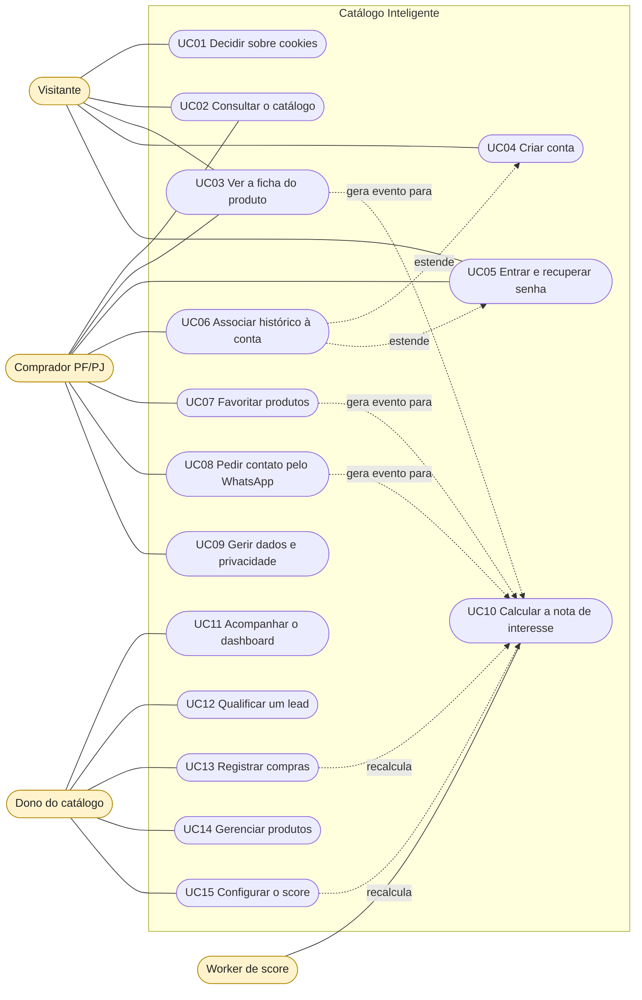

# Casos de uso

Casos de uso do sistema, com os fluxos como estão implementados. Requisitos: [02](02-REQUISITOS.md). Telas: [03](03-PAGINAS-E-UX.md). Rotas: [11](11-API-ENDPOINTS.md).

## 1. Atores

| Ator | Quem é |
|---|---|
| **Visitante** | Pessoa sem conta. Navega e, se aceitar os cookies, tem o comportamento registrado |
| **Comprador** | Pessoa física (PF) ou jurídica (PJ) com conta |
| **Dono do catálogo** | Conta `ADMIN`, criada pela TI |
| **Worker de score** | Processo do sistema que consome a fila e recalcula as notas |

## 2. Diagrama

## 3. Fluxos de negócio completos

| Fluxo | Casos de uso | Resultado |
|---|---|---|
| **A. Da navegação ao contato** | UC01 → UC02 → UC03 → UC07 → UC08 → UC10 | O comprador fala com a empresa no WhatsApp e vira lead com nota |
| **B. Do lead à venda** | UC11 → UC12 → contato externo → UC13 → UC10 | O dono do catálogo prioriza, contata e registra a compra, que volta para a nota |
| **C. Do visitante à conta** | UC01 → UC03 → UC04 ou UC05 → UC06 → UC02 | O histórico anônimo passa para a conta, com permissão, e a vitrine já sai personalizada |
| **D. Da configuração ao efeito** | UC15 → UC10 → UC11 | O dono do catálogo testa um ajuste, salva e vê os níveis mudarem |

---

## 4. Casos de uso do visitante e do comprador

### UC01 — Decidir sobre cookies

| | |
|---|---|
| **Ator** | Visitante ou comprador |
| **Pré-condição** | Primeira visita ou escolha vencida (12 meses) |
| **Fluxo principal** | 1. O sistema mostra o banner. 2. A pessoa escolhe **Aceitar todos**. 3. O sistema guarda a escolha e passa a coletar eventos. |
| **Alternativas** | **Apenas essenciais:** nenhum evento é enviado e o catálogo usa a popularidade. **Personalizar:** abre o modal e a pessoa liga ou desliga os cookies comportamentais. |
| **Resultado** | Consentimento definido no navegador; para quem tem conta, também no banco, com data e versão |
| **Rastreabilidade** | RF04, RF27, RF28 · tela S4 · `POST /api/conta/consentimentos` |

### UC02 — Consultar o catálogo

| | |
|---|---|
| **Ator** | Visitante ou comprador |
| **Pré-condição** | — |
| **Fluxo principal** | 1. A pessoa abre a vitrine ou o catálogo. 2. O sistema ordena os produtos pela mistura de nota pessoal e popularidade. 3. A pessoa busca um termo, filtra por categoria ou preço. 4. O sistema atualiza a lista e guarda os filtros na URL. |
| **Alternativas** | **Até 2 interações ou sem consentimento:** ordem só por popularidade. **Nada encontrado:** aviso com "Limpar filtros". **Preço mínimo maior que o máximo:** marca os campos e não filtra. |
| **Resultado** | Lista ordenada; com consentimento, eventos `PESQUISA` e `FILTRO_APLICADO` |
| **Rastreabilidade** | RF08–RF11, RF17 · telas 1 e 5 · `GET /api/produtos`, `GET /api/categorias`, `POST /api/eventos` |

### UC03 — Ver a ficha do produto

| | |
|---|---|
| **Ator** | Visitante ou comprador |
| **Pré-condição** | Produto ativo |
| **Fluxo principal** | 1. A pessoa abre um produto. 2. O sistema mostra galeria, preço, descrição e ficha técnica. 3. Com consentimento, registra a visualização, a rolagem (25, 50, 75 e 100%) e o tempo ativo. |
| **Alternativas** | **Produto inexistente ou inativo:** página 404. **Visitante:** no lugar do contato aparece "Entrar para contatar". |
| **Resultado** | Eventos na fila para o UC10 |
| **Rastreabilidade** | RF12, RF15, RF16 · tela 6 · `GET /api/produtos/{slug}`, `POST /api/eventos` |

### UC04 — Criar conta

| | |
|---|---|
| **Ator** | Visitante |
| **Pré-condição** | Não estar logado |
| **Fluxo principal** | 1. A pessoa escolhe PJ ou PF e preenche os dados. 2. Aceita os Termos e a Política. 3. O sistema valida CPF ou CNPJ, e-mail e telefone. 4. Cria a conta, grava os consentimentos e já entra. |
| **Alternativas** | **E-mail, CPF ou CNPJ já usado:** erro 409. **Documento inválido:** erro 400. **Sem aceite:** o envio fica bloqueado. **Há navegação anônima:** segue para o UC06. |
| **Resultado** | Conta criada e sessão iniciada |
| **Rastreabilidade** | RF01–RF04, RNF09 · tela 3 · `POST /api/auth/signup` |

### UC05 — Entrar e recuperar senha

| | |
|---|---|
| **Ator** | Visitante, comprador ou dono do catálogo |
| **Pré-condição** | Ter conta |
| **Fluxo principal** | 1. A pessoa informa e-mail e senha. 2. O sistema confere e devolve um token válido por 24 horas. 3. Volta para a página de origem. |
| **Alternativas** | **Credencial errada:** mensagem genérica. **Admin na entrada pública, ou comprador na entrada admin:** a mesma mensagem. **Mais de 5 tentativas por minuto:** erro 429. **Esqueceu a senha:** pede o código, válido por 2 horas, e define a nova senha. O código sai no log do backend; não há envio de e-mail. |
| **Resultado** | Sessão iniciada ou senha trocada |
| **Rastreabilidade** | RF05–RF07, RNF04, RNF06, RNF07 · telas 2, 4 e A1 · `POST /api/auth/login`, `POST /api/admin/auth/login`, `POST /api/auth/password-reset` e `/confirm` |

### UC06 — Associar histórico à conta

| | |
|---|---|
| **Ator** | Comprador |
| **Pré-condição** | Ter navegado sem conta neste navegador e acabado de entrar ou se cadastrar |
| **Fluxo principal** | 1. O sistema pergunta se deve associar o histórico. 2. A pessoa aceita. 3. Sessões, eventos e notas passam para a conta. |
| **Alternativas** | **Recusa:** nada é associado nem apagado. **Nota repetida para o mesmo produto:** fica a maior. |
| **Resultado** | O histórico anônimo passa a contar para o comprador |
| **Rastreabilidade** | RF19 · telas 2 e 3 · `POST /api/auth/migrar-historico` |

### UC07 — Favoritar produtos

| | |
|---|---|
| **Ator** | Comprador |
| **Pré-condição** | Estar logado |
| **Fluxo principal** | 1. O comprador marca o produto na ficha. 2. O sistema salva o favorito e envia `FAVORITAR`. 3. O produto aparece em Favoritos. |
| **Alternativas** | **Remover:** sai na hora, com "Desfazer" por 8 segundos, e envia `DESFAVORITAR`. |
| **Resultado** | Lista de favoritos atualizada; o evento soma ou subtrai na nota |
| **Rastreabilidade** | RF13, RF17 · telas 6 e 7 · `GET/POST/DELETE /api/favoritos` |

### UC08 — Pedir contato pelo WhatsApp

| | |
|---|---|
| **Ator** | Comprador |
| **Pré-condição** | Estar logado |
| **Fluxo principal** | 1. O comprador clica em "Entrar em contato" na ficha. 2. O sistema envia `CONTATO_WHATSAPP` com conversão leve. 3. Abre o WhatsApp com a mensagem pronta. |
| **Alternativas** | **Pelos favoritos:** conversão forte. **Sem consentimento:** abre o WhatsApp sem registrar o evento. |
| **Resultado** | Contato iniciado; o decaimento do produto fica pausado por 60 dias |
| **Rastreabilidade** | RF14 · telas 6 e 7 · `POST /api/eventos` |

### UC09 — Gerir dados e privacidade

| | |
|---|---|
| **Ator** | Comprador |
| **Pré-condição** | Estar logado |
| **Fluxo principal** | 1. O comprador abre Conta. 2. Edita os dados ou liga e desliga um consentimento. 3. O sistema salva e registra o consentimento com data e versão. |
| **Alternativas** | **Exportar:** baixa os dados em JSON ou CSV. **Excluir conta:** após confirmar, os dados pessoais são apagados (anonimização) e a sessão termina. |
| **Resultado** | Direitos da LGPD exercidos sem depender de atendimento |
| **Rastreabilidade** | RF28–RF30, RNF08, RNF09 · tela 8 · `GET/PATCH/DELETE /api/conta`, `POST /api/conta/consentimentos`, `GET /api/conta/exportar` |

---

## 5. Caso de uso do sistema

### UC10 — Calcular a nota de interesse

| | |
|---|---|
| **Ator** | Worker de score |
| **Pré-condição** | Evento na fila |
| **Fluxo principal** | 1. O worker recebe o evento e o grava. 2. Soma, por produto, peso × valor × decaimento. 3. Divide pelo máximo possível e limita de 0 a 100. 4. Calcula a nota das categorias e a faixa de preço. 5. Grava as notas. |
| **Alternativas** | **Contato nos últimos 60 dias:** sem decaimento. **Menos de 3 compras:** elas não entram. **Falha no cálculo:** nada é gravado e a mensagem volta para a fila. |
| **Resultado** | Notas atualizadas: Quente (70 ou mais), Morno (40 a 69) ou Frio (abaixo de 40) |
| **Rastreabilidade** | RF08, RF09, RNF02 · [04 §4–5](04-ESPECIFICACAO-TECNICA.md) · [05 §5](05-ARQUITETURA.md) |

---

## 6. Casos de uso do dono do catálogo

### UC11 — Acompanhar o dashboard

| | |
|---|---|
| **Ator** | Dono do catálogo |
| **Pré-condição** | Estar logado como admin |
| **Fluxo principal** | 1. Abre o dashboard. 2. O sistema mostra os indicadores, o nível de interesse dos clientes, a categoria favorita e os contatos dos últimos 14 dias. 3. Clica em "Ver" nos clientes com alto interesse. 4. Chega à lista de usuários filtrada por Quente. |
| **Alternativas** | **Sem dados:** cada gráfico mostra um aviso. |
| **Resultado** | Visão de quem priorizar |
| **Rastreabilidade** | RF20, RF21 · telas A2 e A3 · `GET /api/admin/dashboard`, `GET /api/admin/usuarios` |

### UC12 — Qualificar um lead

| | |
|---|---|
| **Ator** | Dono do catálogo |
| **Pré-condição** | Cliente cadastrado |
| **Fluxo principal** | 1. Filtra e ordena os usuários por nota. 2. Abre o detalhe. 3. Vê as notas por produto e categoria e a faixa de preço com e sem contato. 4. Abre o WhatsApp do cliente (**pendente:** hoje o botão abre o número da loja). |
| **Alternativas** | **Diferença de preço maior que R$ 10:** aviso de possível barreira de preço. **Sem telefone:** botão desabilitado com explicação. |
| **Resultado** | Contato com contexto do que o cliente procura |
| **Rastreabilidade** | RF21, RF22 · telas A3 e A4 · `GET /api/admin/usuarios/{id}` |

### UC13 — Registrar compras

| | |
|---|---|
| **Ator** | Dono do catálogo |
| **Pré-condição** | Cliente cadastrado |
| **Fluxo principal** | 1. No detalhe do cliente, informa produto, quantidade, preço e data. 2. O sistema calcula o total, salva e recalcula a nota. |
| **Alternativas** | **Editar ou excluir:** também recalcula. **Menos de 3 compras:** aviso de que ainda não contam na nota. |
| **Resultado** | Histórico de compras e nota atualizados |
| **Rastreabilidade** | RF24 · tela A4 · `POST/PUT/DELETE /api/admin/usuarios/{id}/compras` |

### UC14 — Gerenciar produtos

| | |
|---|---|
| **Ator** | Dono do catálogo |
| **Pré-condição** | Estar logado como admin |
| **Fluxo principal** | 1. Cria ou edita um produto, com ficha técnica e imagens. 2. O sistema valida e salva. 3. O produto ativo aparece no catálogo. |
| **Alternativas** | **Desativar:** some do catálogo e pode ser reativado. **Preço zero ou nome vazio:** recusado. **Arquivo que não é JPEG, PNG ou WebP, ou acima de 5 MB:** recusado. |
| **Resultado** | Catálogo atualizado |
| **Rastreabilidade** | RF23 · telas A5 a A7 · `GET/POST/PATCH /api/admin/produtos`, `POST /api/admin/produtos/imagens` |

### UC15 — Configurar o score

| | |
|---|---|
| **Ator** | Dono do catálogo |
| **Pré-condição** | Estar logado como admin |
| **Fluxo principal** | 1. Ajusta os pesos, a duração do interesse ou o bônus por categoria. 2. O sistema mostra quem mudaria de nível e a precisão, sem gravar. 3. Salva, com a opção de recalcular todas as notas. |
| **Alternativas** | **Desfazer** ou **Restaurar padrão:** nada é gravado até salvar. **Ajuste por categoria:** criar ou remover. **Sem histórico suficiente:** a precisão aparece vazia. |
| **Resultado** | Parâmetros novos valendo, sem novo deploy |
| **Rastreabilidade** | RF25, RNF13 · tela A9 · `GET/PATCH …/configuracao/pesos` e `/decay`, `DELETE …/decay/{categoriaId}`, `POST …/simular`, `POST …/recalcular` |

---

## 7. Matriz RF × caso de uso

| RF | Caso de uso | RF | Caso de uso |
|---|---|---|---|
| RF01–RF03 | UC04 | RF17 | UC02, UC07 |
| RF04 | UC01, UC04, UC09 | RF18 | UC01, UC03 |
| RF05 | UC05 | RF19 | UC06 |
| RF06 | UC05 | RF20 | UC11 |
| RF07 | UC05 | RF21 | UC11, UC12 |
| RF08–RF09 | UC02, UC10 | RF22 | UC12 |
| RF10–RF11 | UC02 | RF23 | UC14 |
| RF12 | UC03 | RF24 | UC13 |
| RF13 | UC07 | RF25 | UC15 |
| RF14 | UC08 | RF26 | tela A8 (dados da própria conta admin) |
| RF15 | UC03 | RF27 | UC01 |
| RF16 | UC03 | RF28–RF30 | UC09 |
